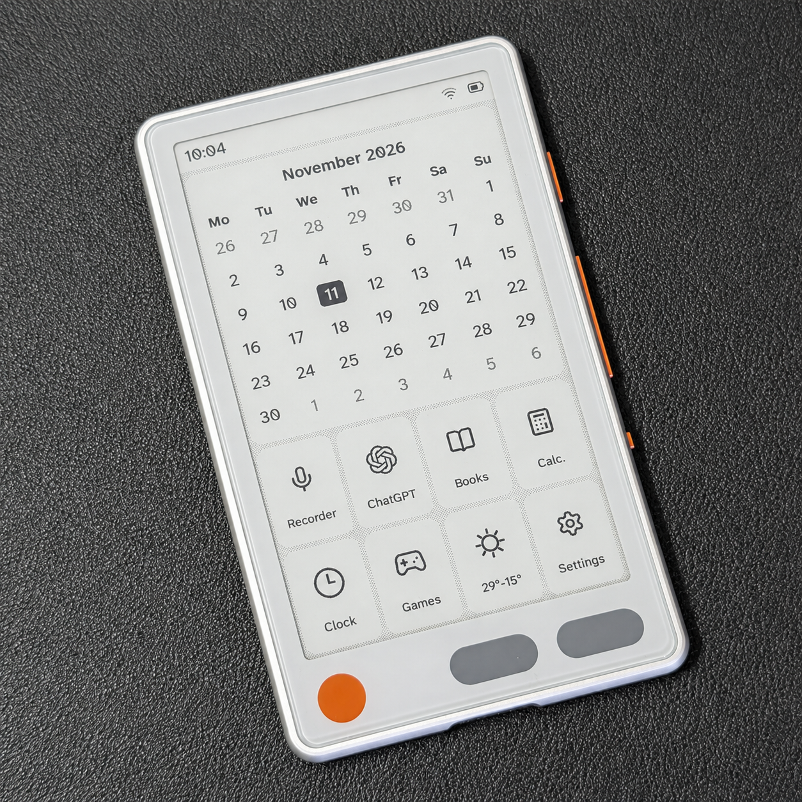
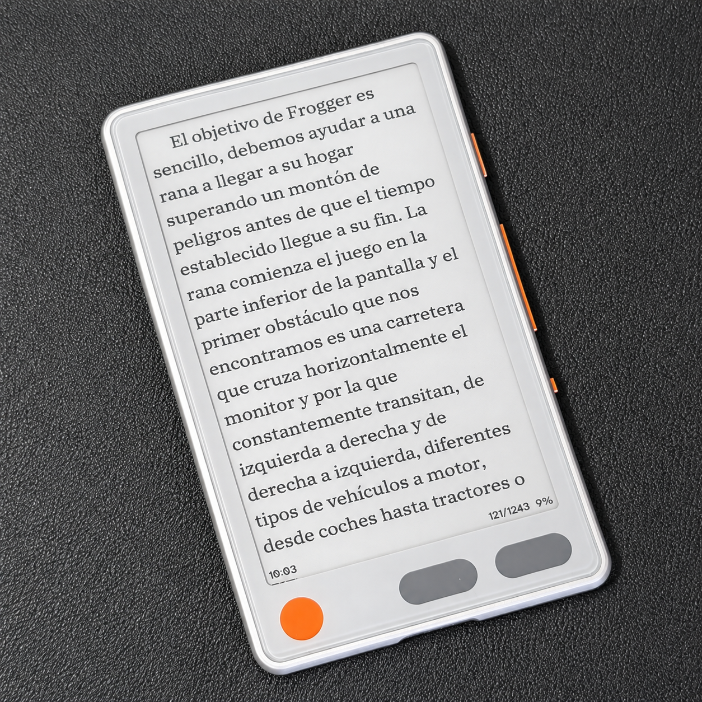
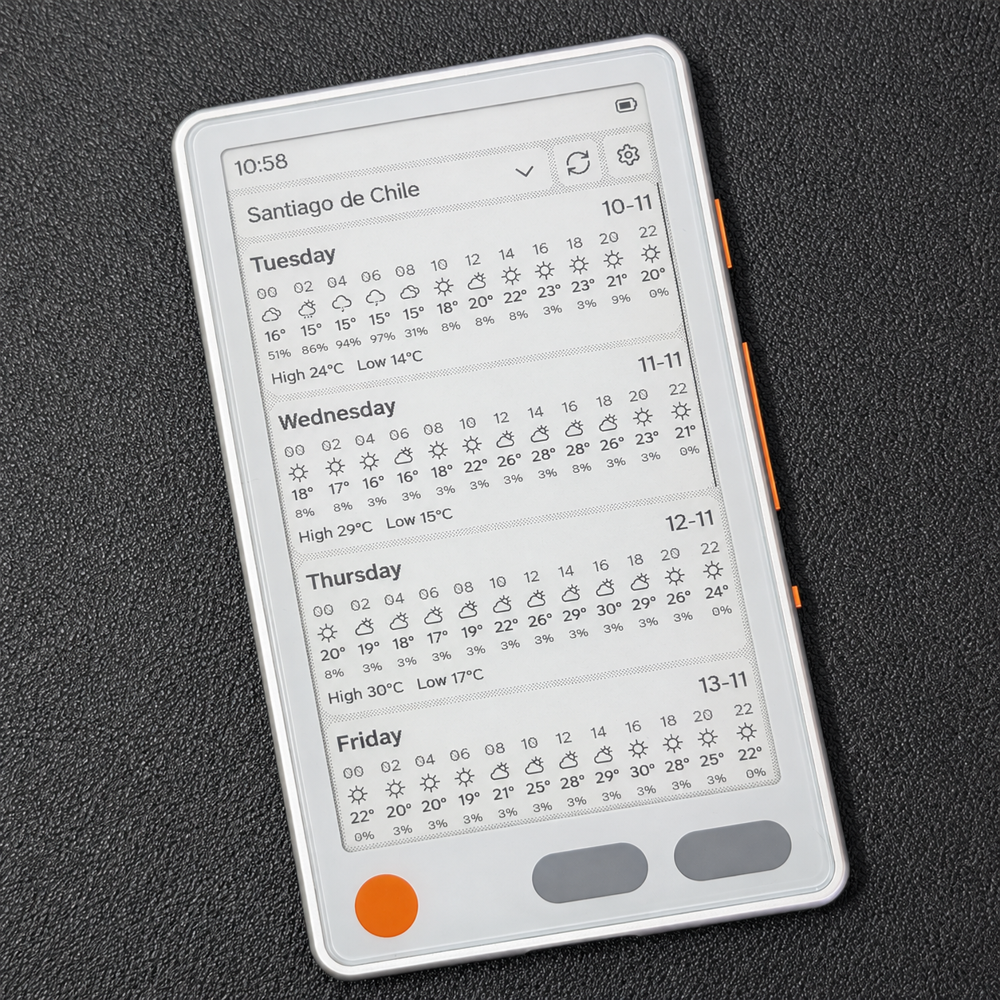
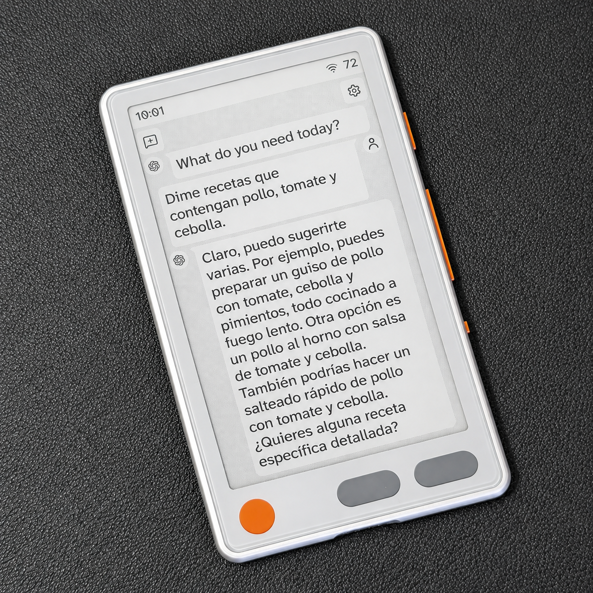
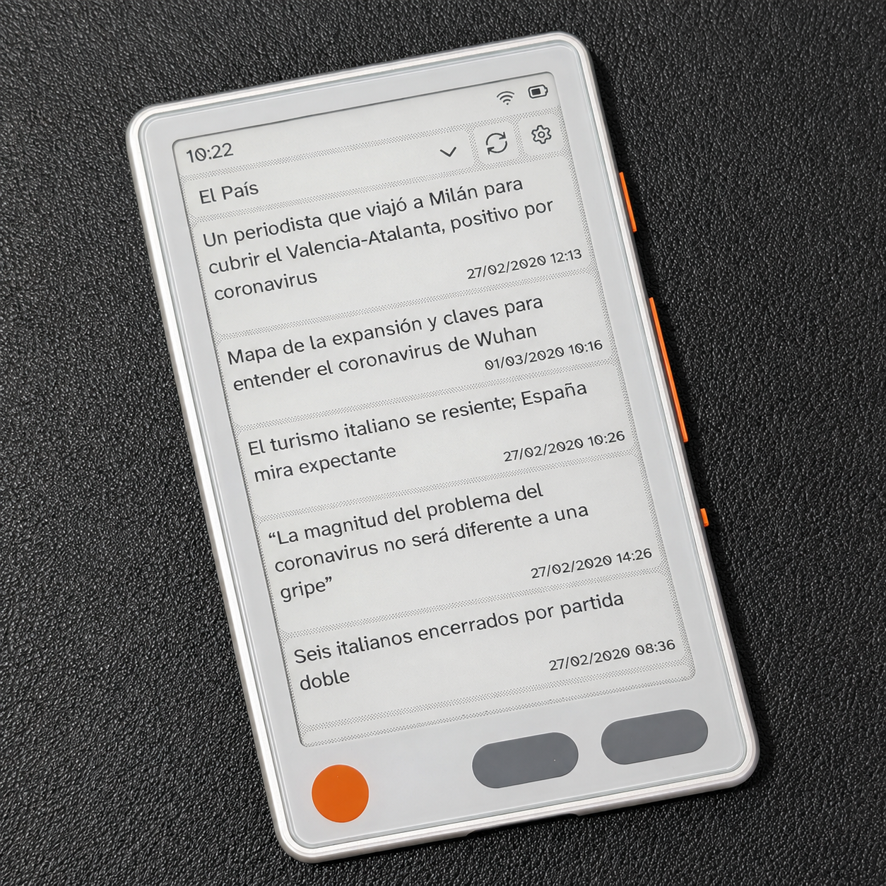
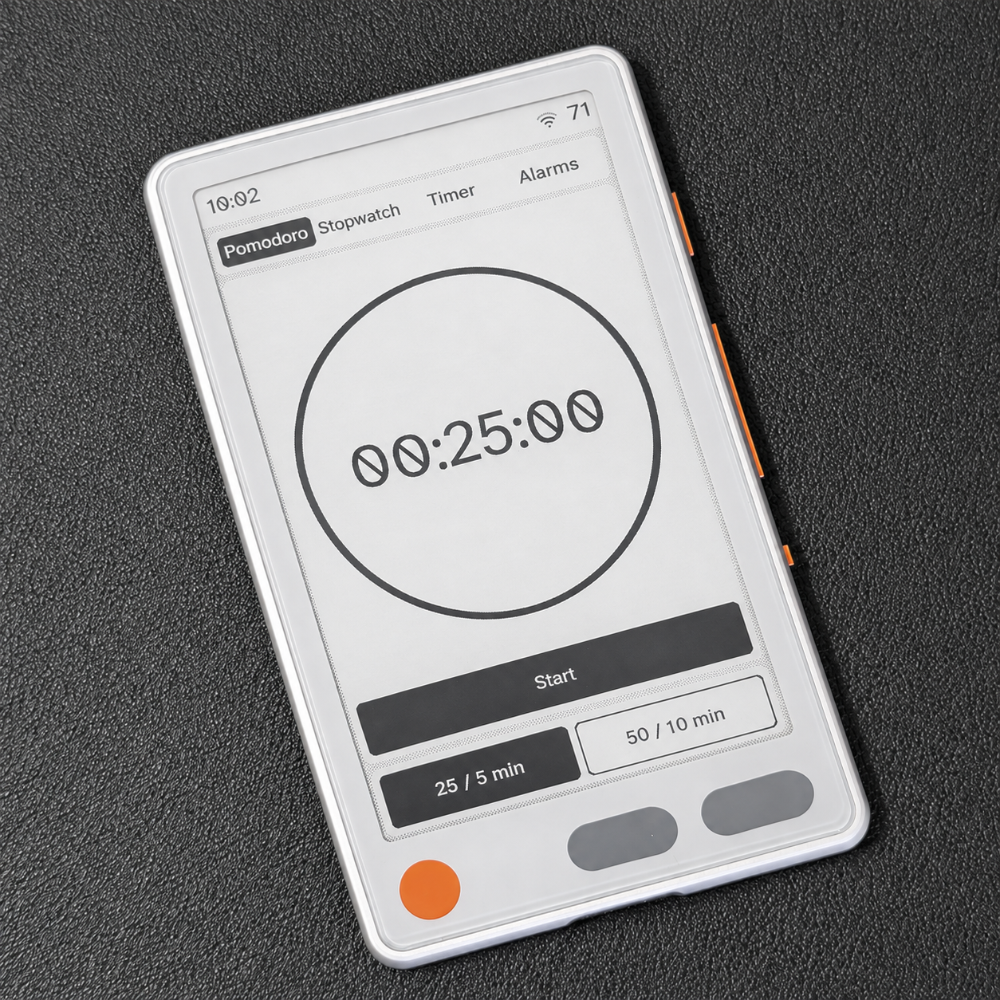
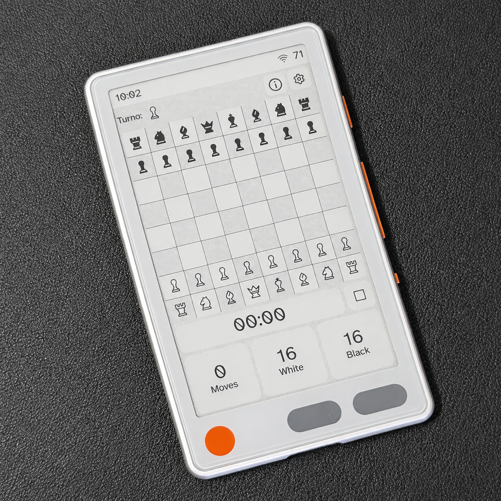
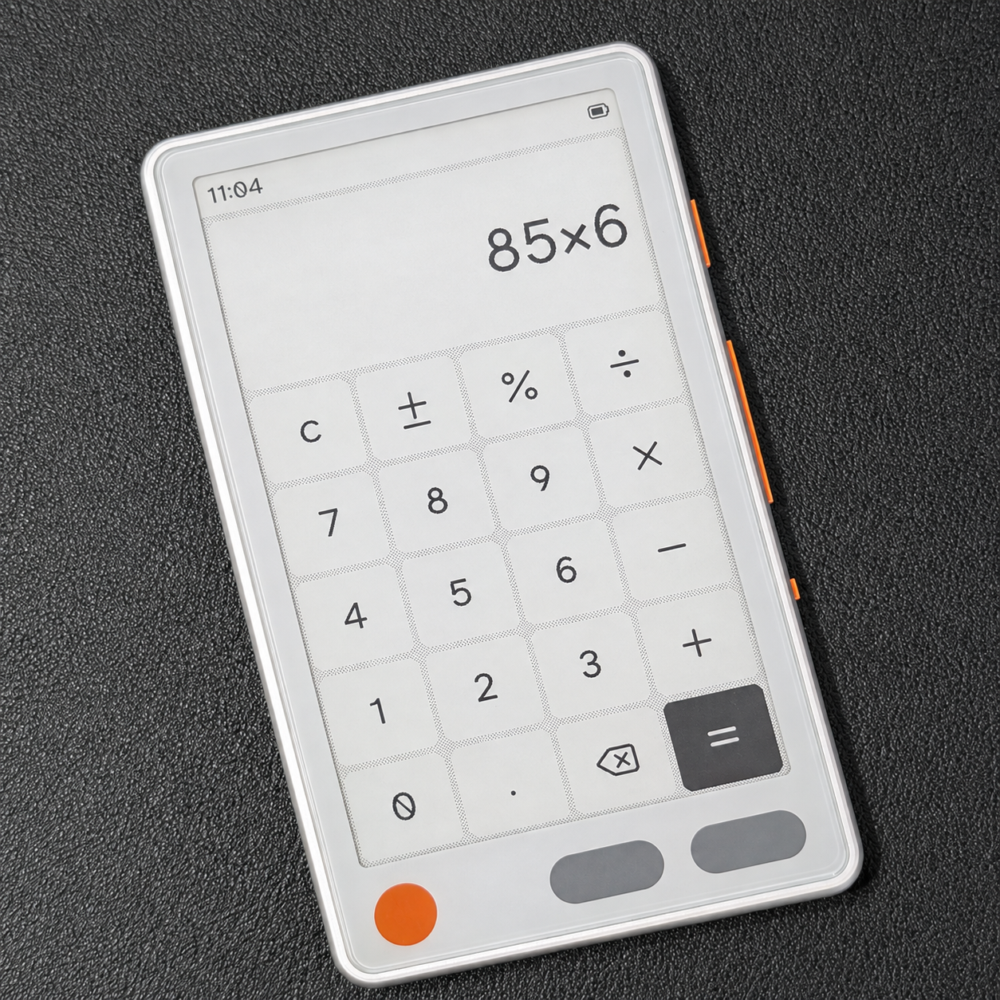
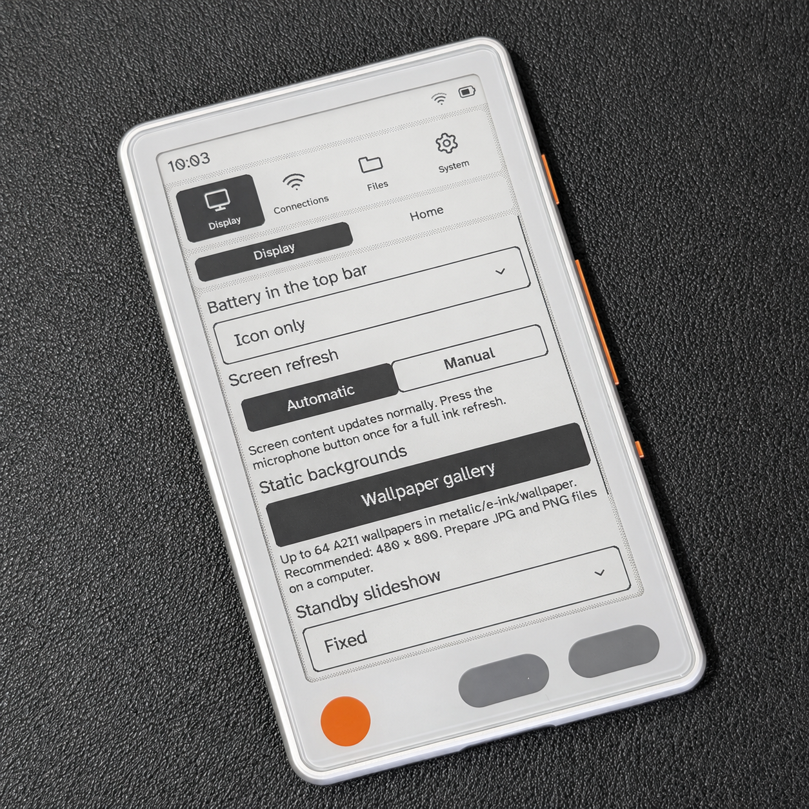

# DoceInk · Metalio

[English](README.md) | **Español**

<picture>
  <source media="(prefers-color-scheme: dark)" srcset="assets/doceink-logo-dark.svg">
  <source media="(prefers-color-scheme: light)" srcset="assets/doceink-logo-light.svg">
  
</picture>

Firmware para **Metalio E-Ink4**, el lector de tinta electrónica con ESP32-S3 y memoria flash de 16 MB. Libros, tareas locales, ChatGPT por voz, noticias RSS, clima, grabadora local, reloj, calculadora y juegos en una misma interfaz.

**Versión documentada: 0.75.194.** Este repositorio reúne descargas y documentación para instalar y utilizar Metalio.

## Explora DoceInk

| Inicio | Lectura | Clima |
| :---: | :---: | :---: |
|  |  |  |

Ver más pantallas

 

| ChatGPT | Noticias | Pomodoro |
| :---: | :---: | :---: |
|  |  |  |
| Ajedrez | Calculadora | Ajustes |
|  |  |  |

Las pantallas pueden variar ligeramente según la versión del firmware.

## Instalar desde cero

### Descargar el instalador

| Ordenador | Descarga |
| --- | --- |
| Windows 10/11 · x64 | [DoceInk Setup](https://github.com/Faga250885/Doceink/releases/latest/download/DoceInk-Setup-0.75.158.1.exe) |
| Mac · Apple Silicon (M1 o posterior) · macOS 15+ | [DoceInk Setup para Apple Silicon](https://github.com/Faga250885/Doceink/releases/latest/download/DoceInk-Setup-0.75.158.1-macOS-arm64.dmg) |

**Conecta Metalio → abre DoceInk Setup → pulsa Instalar.** Lo detecta automáticamente, sin elegir puertos COM ni serie. Sin Python, comandos ni descargar el firmware manualmente. Cada instalación obtiene la última versión estable de GitHub y requiere internet. Se abre en inglés y permite cambiar a español. Si hay varios dispositivos USB compatibles, deja conectado solo el Metalio.

El instalador **0.75.158.1** añade respaldo y restauración opcionales del firmware original, y actualización USB para equipos con DoceInk; el firmware está en **0.75.194**. La app de Mac todavía no tiene firma Apple Developer ID ni notarización, por lo que Gatekeeper podría impedir abrirla. Sigue la **[guía de instalación](docs/INSTALACION.md)** para consultar requisitos, firma y conexión.

El paquete se genera con los archivos del firmware y sus recursos: **no incluye cuentas, claves API, redes Wi-Fi guardadas, conversaciones ni archivos personales del desarrollador**. Cada persona configura su propio Metalio.

> La instalación limpia reemplaza la memoria interna del Metalio de destino y borra sus cuentas y ajustes. **No borra la microSD.** Usa una tarjeta vacía si también quieres empezar sin libros, tareas o historiales anteriores.
>
> Estado de validación: compilación, pruebas de software, integridad del ZIP y regiones vacías de la imagen verificadas. El propietario confirmó una instalación limpia completa con el instalador de Windows en un Metalio físico. Esta versión todavía requiere prueba física; la instalación USB desde macOS sigue sin validar.

## Elegir la descarga correcta

| Quiero… | Archivo o método | Qué ocurre con mis datos |
| --- | --- | --- |
| Instalar desde cero en un Metalio compatible | DoceInk Setup para Windows o macOS, por USB | Reemplaza toda la memoria interna; conserva la microSD |
| Actualizar un Metalio que ya utiliza Doceink | Ajustes → Sistema → Información → Comprobar actualización | Conserva cuentas, ajustes y archivos |
| Obtener el firmware de actualización | `Doceink-EInk4.bin` en Releases | Es la aplicación OTA, no un instalador completo |

**No uses `Metalio-instalacion-limpia.bin` para actualizar por Wi-Fi.** Tampoco basta con copiar ese archivo a la microSD: se instala por USB siguiendo la guía.

- [Última publicación y descargas](https://github.com/Faga250885/Doceink/releases/latest)
- [Actualizar conservando los datos](docs/ACTUALIZACIONES.md)
- [Huellas SHA-256 de 0.75.194](SHA256SUMS.txt)
- [Historial de versiones](https://github.com/Faga250885/Doceink/releases)

## Qué incluye

Al encender, el nuevo logo con la palabra **doceink** aparece centrado durante dos segundos. El mismo logo aparece en Información.

| Sección | Funciones |
| --- | --- |
| Libros | Biblioteca, portadas, gestos táctiles e índice modal con scrollbar e ítems centrados verticalmente; texto de muestra traducido y vista previa de la barra informativa bajo los ajustes |
| Tareas | Listas locales Personal y Trabajo; dictado por Wi-Fi |
| ChatGPT | Conversaciones por voz e historial en microSD; requiere configurar tu propia clave API |
| Noticias | Varias fuentes RSS, caché en microSD y actualización manual |
| Clima | Pronóstico guardado en microSD, resumen diurno de 08:00 a 20:00, actualización manual y unidades Celsius/Fahrenheit |
| Grabadora | Grabación WAV local en microSD, pausa y reanudación; sigue grabando en standby |
| Reloj | Reloj, pomodoro, cronómetro y cuenta atrás |
| Archivos | Disco USB y transferencia por Wi-Fi desde el navegador del teléfono mediante QR |
| Home y ajustes | Accesos personalizables, fondos, batería, conexión y preferencias |
| Juegos | Ajedrez, Sudoku, 2048, Buscaminas, Batalla naval y Reversi; partidas que se reanudan al salir o entrar en standby; reinicio desde la toolbar con confirmación |
| Otras aplicaciones | Calculadora |

El reloj ofrece **Configurar automáticamente** por Wi-Fi o **Configuración manual** en un modal. El modo automático detecta la ciudad aproximada por IP y utiliza reglas IANA para gestionar el horario de verano. Sincroniza cuando hay Wi-Fi por una acción del usuario; no inicia una conexión al encender. Los contadores activos siempre son compatibles con standby.

Controles del lector: mantén pulsado para el menú, desliza arriba o abajo para los capítulos y horizontalmente para pasar páginas. El campo de la fuente abre un modal con estado de descarga, progreso en cada fila y nombres con la letra normal del sistema. Se puede ajustar el espaciado entre letras. Pantalla → Home permite editar los accesos en la misma cuadrícula de ocho iconos; Configuración permanece fija.

Las tipografías del lector incluyen un catálogo de **30 familias descargables**. Al elegir una se guarda en la microSD con sus tamaños compatibles y después funciona sin internet. Solo se descarga tras seleccionarla; se conservan las fuentes existentes. **Ajustes → Pantalla → Apariencia → Tipografía del sistema** ofrece exactamente cuatro familias para la interfaz: Atkinson (predeterminada integrada), Inter, Source Sans 3 y Noto Sans. Los tres paquetes opcionales, preparados a tamaños nativos, se descargan una vez a la microSD al seleccionarlos y después funcionan sin internet. Al actualizar desde la 0.75.190 se restaura Atkinson. Las fuentes del libro son independientes. El paquete de interfaz queda en PSRAM con el archivo cerrado; los caracteres ausentes usan el respaldo interno. El paquete tipográfico de la instalación limpia baja de 4,99 MB a 2,59 MB; la OTA habitual conserva la partición de fuentes instalada anteriormente.

Información incluye **Notas de actualización** bajo Comprobar actualización, con notas traducidas y sin internet de la versión instalada y la anterior. El reloj muestra **Configurando...** mientras trabaja. La justificación llega a ambos márgenes salvo los finales de párrafo y las iniciales biónicas quedan más marcadas.

Las partidas permanecen en memoria mientras Metalio siga encendido; se borran al apagarlo o reiniciarlo.

Los títulos del clima usan la franja de 08:00 a 20:00, ambas incluidas, en la hora local de la ciudad del pronóstico. En días secos se usa la temperatura media de esa franja: caluroso desde 30°C, frío hasta 10°C y helado hasta 0°C. El botón de salir del ajedrez terminado vuelve al tablero inicial y a Empezar la partida.

Las conversaciones nuevas y el dictado necesitan conexión a internet y la configuración correspondiente. Los historiales y datos ya guardados se consultan desde la microSD. Noticias y Clima necesitan una primera descarga para tener contenido disponible sin conexión.

## Empezar a usarlo

1. Instala el firmware y arranca Metalio.
2. Inserta tu microSD y configura tu red Wi-Fi de 2,4 GHz.
3. Añade tus libros y fondos desde **Ajustes → Archivos**.
4. Configura tus propias fuentes RSS, ciudad y, si vas a usar ChatGPT, tu clave API.

Consulta la [guía de primeros pasos](docs/PRIMEROS-PASOS.md) para conocer los controles, las carpetas y la transferencia de archivos.

## Compatibilidad y ayuda

Este instalador está preparado **exclusivamente para Metalio E-Ink4, ESP32-S3, flash de 16 MB**. No es un firmware universal para cualquier lector o placa ESP32.

La versión 0.75.180 corrige una fuente no disponible en la bienvenida del lector que podía bloquear la apertura. Consulta las [notas de la versión](https://github.com/Faga250885/Doceink/releases/tag/v0.75.180) para conocer la validación y sus límites.

- [Preguntas frecuentes y solución de problemas](docs/PREGUNTAS-FRECUENTES.md)
- [Informar un problema](https://github.com/Faga250885/Doceink/issues/new?template=problema.md)
- [Licencia incluida con el firmware](LICENSE)

El firmware se apoya en ESP-IDF, LVGL y otros componentes de terceros, que conservan sus respectivas licencias. La licencia principal no sustituye las de esos componentes.

Creado por faga12@gmail.com

Idiomas de la interfaz: inglés (predeterminado al instalar desde cero), español y chino simplificado. Las actualizaciones conservan el idioma elegido.
