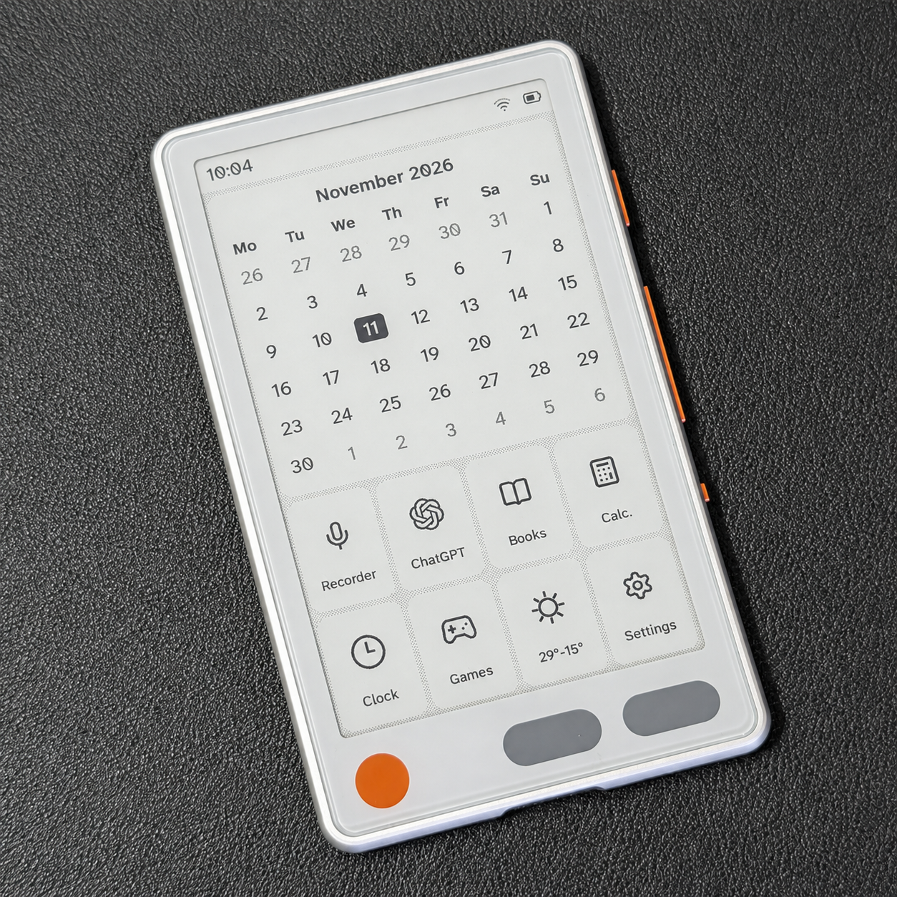
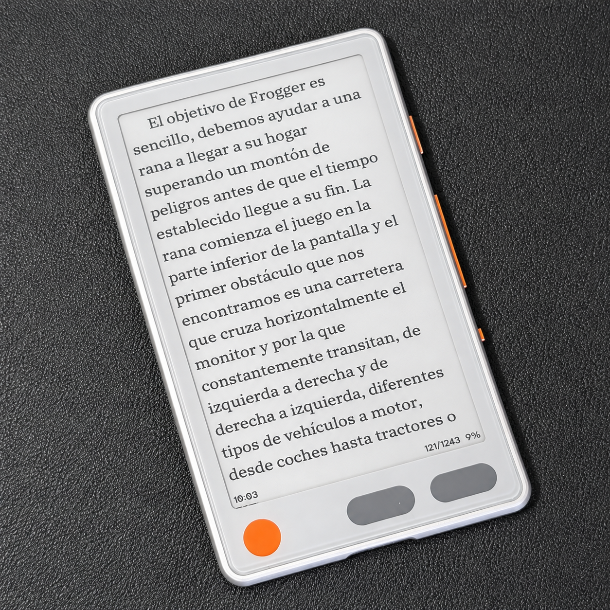
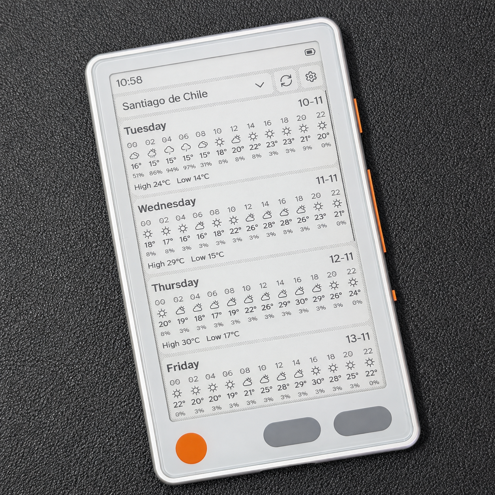
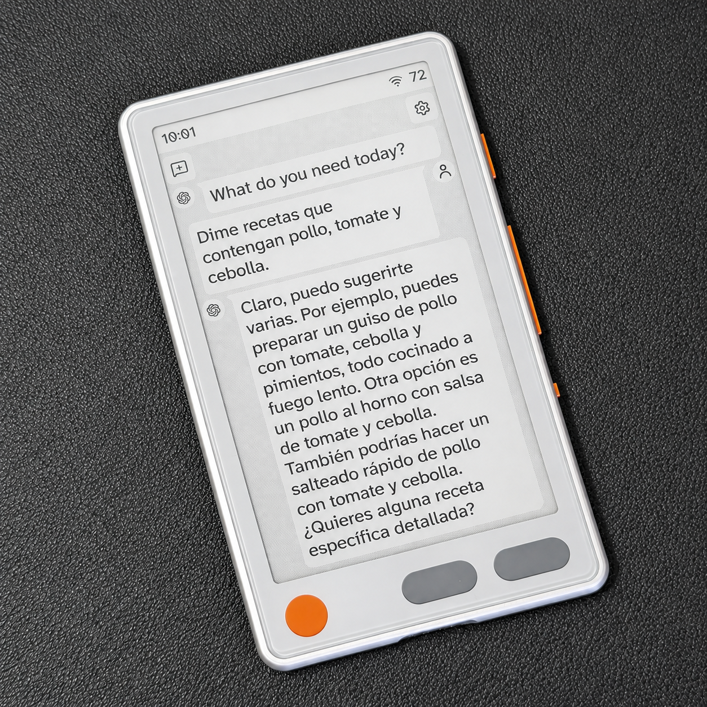
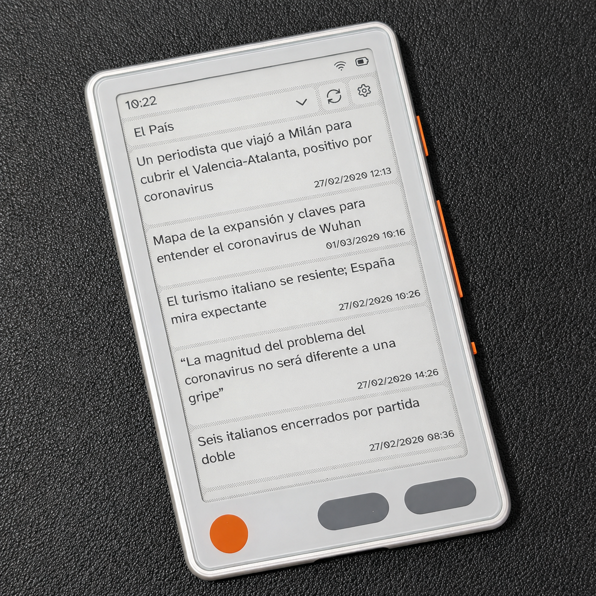
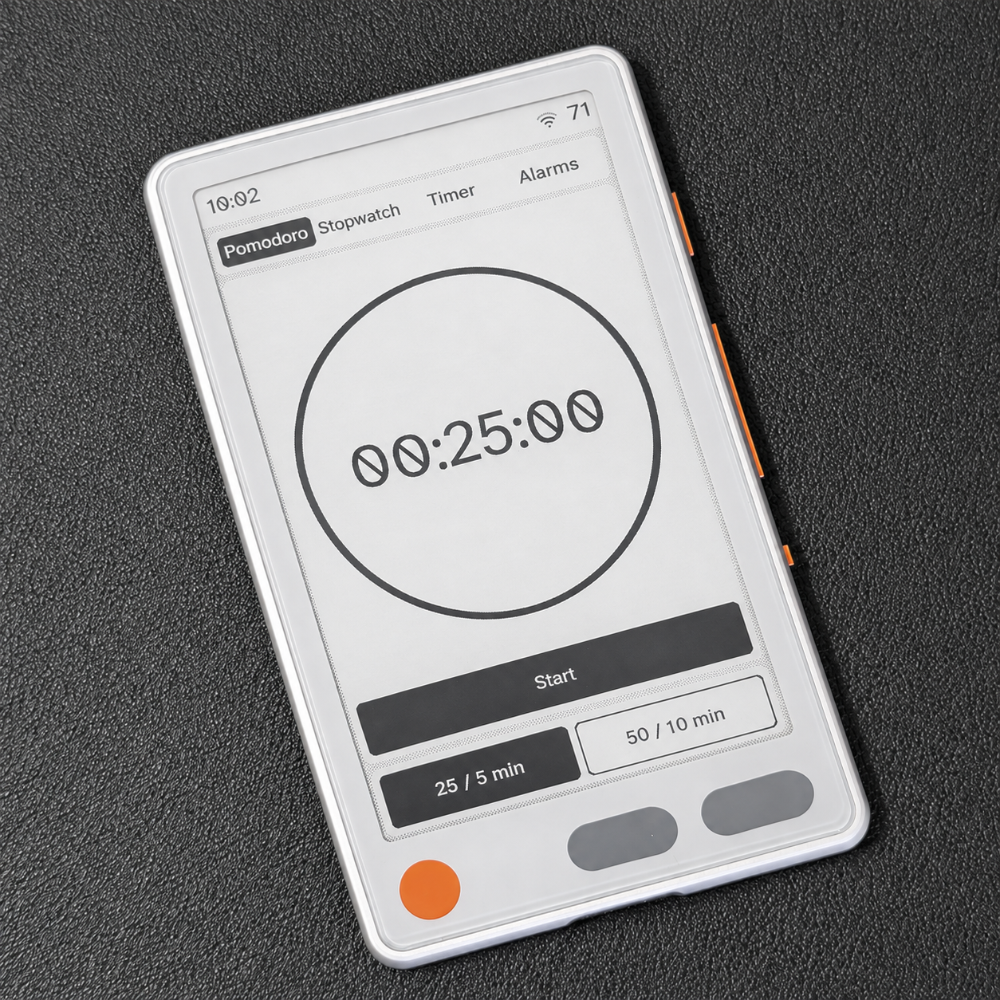
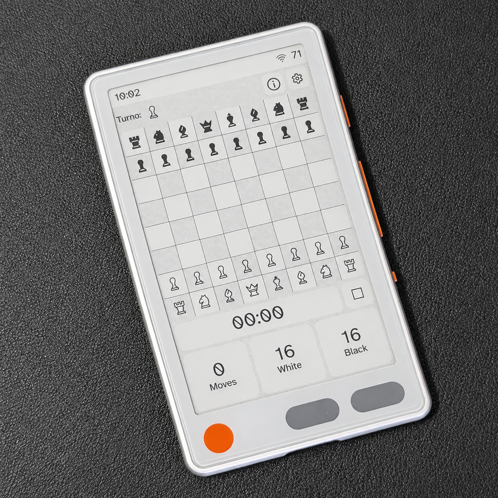
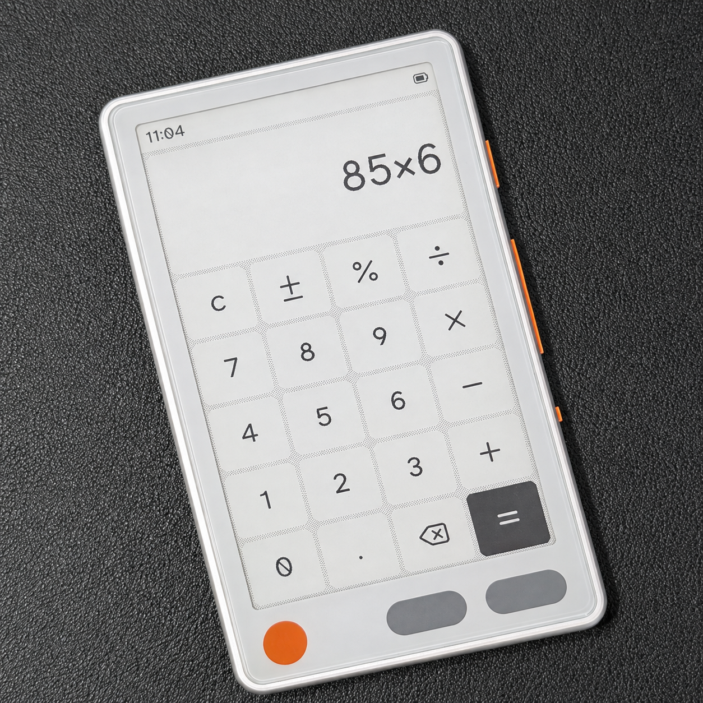
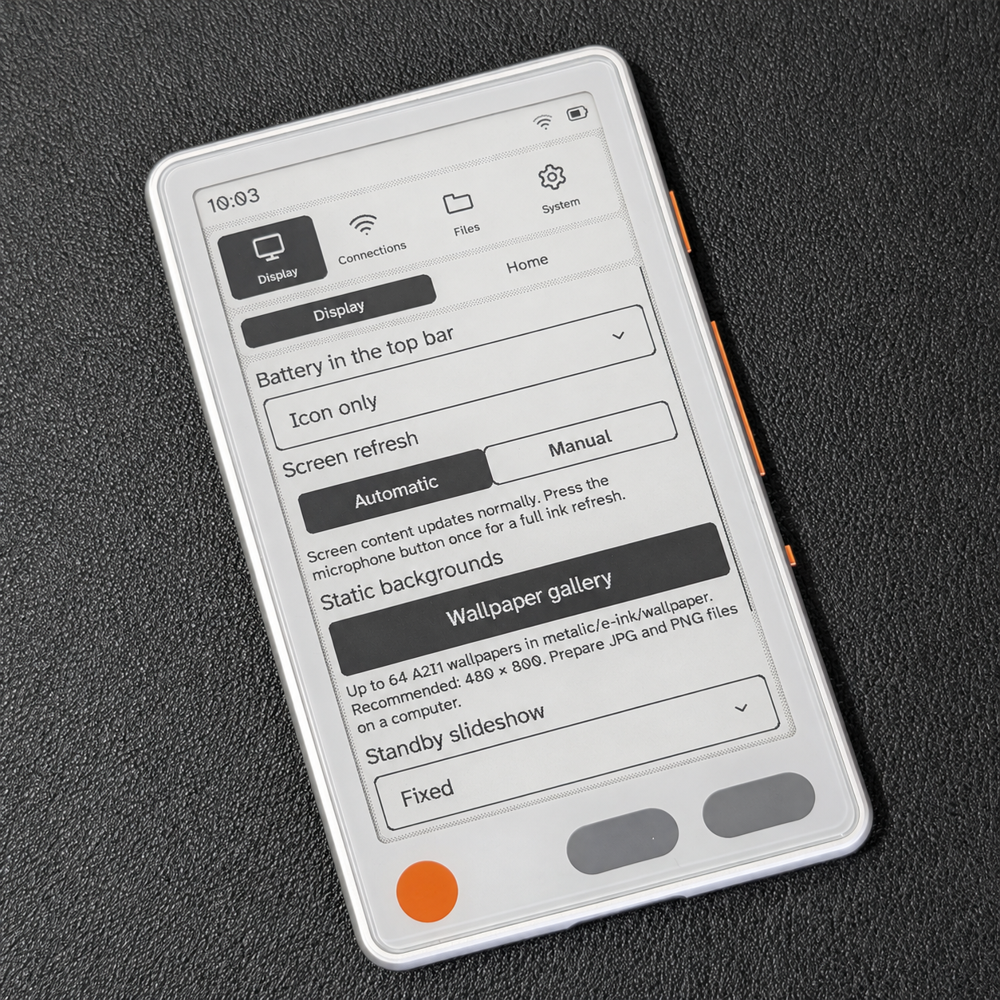

# DoceInk · Metalio

**English** | [Español](README.es.md)

<picture>
  <source media="(prefers-color-scheme: dark)" srcset="assets/doceink-logo-dark.svg">
  <source media="(prefers-color-scheme: light)" srcset="assets/doceink-logo-light.svg">
  
</picture>

Firmware for **Metalio E-Ink4**, an e-paper reader powered by an ESP32-S3 with 16 MB of flash. Books, local tasks, voice conversations with ChatGPT, RSS news, weather, an offline audio recorder, a clock, a calculator and games in one interface.

**Documented version: 0.75.179.** This repository provides downloads and documentation for installing and using Metalio.

## Explore DoceInk

| Home | Reading | Weather |
| :---: | :---: | :---: |
|  |  |  |

See more screens

 

| ChatGPT | News | Pomodoro |
| :---: | :---: | :---: |
|  |  |  |
| Chess | Calculator | Settings |
|  |  |  |

Screens may vary slightly between firmware versions.

## Install from scratch

### Download the installer

| Computer | Download |
| --- | --- |
| Windows 10/11 · x64 | [DoceInk Setup](https://github.com/Faga250885/Doceink/releases/latest/download/DoceInk-Setup-0.75.158.1.exe) |
| Mac · Apple Silicon (M1 or later) · macOS 15+ | [DoceInk Setup for Apple Silicon](https://github.com/Faga250885/Doceink/releases/latest/download/DoceInk-Setup-0.75.158.1-macOS-arm64.dmg) |

**Connect Metalio → open DoceInk Setup → click Install.** Detection is automatic; there is no COM/serial-port selector. No Python, terminal commands or manual firmware download. Internet is required: every installation downloads the latest stable GitHub release. English by default, with a Spanish selector. If several compatible USB devices are connected, leave only Metalio connected.

Installer **0.75.158.1** adds optional original-firmware backup and restoration, and USB updates for recognized DoceInk devices; firmware is now **0.75.179**. The macOS app is not Apple Developer ID signed or notarized, so Gatekeeper may block opening it. See the **[installation guide](docs/INSTALLATION.md)** for requirements, signing status and troubleshooting.

The package is built from firmware build outputs and system resources. **It contains no developer accounts, API keys, saved Wi-Fi networks, conversations or personal files.** Each user sets up their own Metalio.

> A clean installation replaces the target Metalio's internal flash, erasing its accounts and settings. **It does not erase the microSD card.** Use an empty card if you also want to start without previous books, tasks or conversations.
>
> Validation status: firmware build, software tests, ZIP integrity and blank image regions verified. The owner confirmed a complete clean installation with the Windows installer on a physical Metalio. The new recorder and this firmware release still need on-device validation; macOS USB installation remains unverified.

## Choose the right download

| I want to… | File or method | What happens to my data |
| --- | --- | --- |
| Install from scratch on compatible hardware | DoceInk Setup for Windows or macOS, over USB | Replaces internal flash; preserves the microSD card |
| Update Metalio with Doceink already installed | Settings → System → Information → Check for updates | Preserves accounts, settings and files |
| Download the update firmware | `Doceink-EInk4.bin` in Releases | Contains the OTA application, not a complete installer |

**Do not use `Metalio-instalacion-limpia.bin` for Wi-Fi updates.** Copying the full image to the microSD card is not an installation method either; follow the USB installation guide.

- [Latest release and downloads](https://github.com/Faga250885/Doceink/releases/latest)
- [Update without erasing your data](docs/UPDATES.md)
- [SHA-256 checksums for 0.75.179](SHA256SUMS.txt)
- [Release history](https://github.com/Faga250885/Doceink/releases)

## Features

At power-on, the new DoceInk logo and its **doceink** wordmark appear centered for two seconds. The same logo appears in Information.

| Section | Features |
| --- | --- |
| Books | Library, covers, reading and typography controls |
| Tasks | Local Personal and Work lists; dictation over Wi-Fi |
| ChatGPT | Voice conversations and microSD history; requires your own API key |
| News | Multiple RSS sources, microSD cache and manual refresh |
| Weather | Forecast stored on microSD, manual refresh and Celsius/Fahrenheit units |
| Recorder | Offline WAV recording directly to microSD, pause/resume and recording during standby |
| Clock | Clock, pomodoro, stopwatch and countdown |
| Files | USB disk mode and QR-based Wi-Fi transfers through your phone's browser |
| Home and settings | Customizable shortcuts, wallpapers, battery, connectivity and preferences |
| Games | Chess, Sudoku, 2048, Minesweeper, Battleship and Reversi; resume matches after navigating away or entering standby; restart from the toolbar with confirmation |
| Other apps | Calculator |

Game sessions remain in memory while Metalio stays powered on; powering off or restarting clears them.

New conversations and dictation require internet access and the corresponding account setup. Saved history and downloaded data are read from the microSD card. News and Weather need an initial download before content is available offline.

## Getting started

1. Install the firmware and start Metalio.
2. Insert your microSD card and set up a 2.4 GHz Wi-Fi network.
3. Add books and wallpapers through **Settings → Files**.
4. Configure your RSS sources, city and, if you plan to use ChatGPT, your API key.

See [Getting started](docs/GETTING-STARTED.md) for controls, folders and file transfers. Firmware interface languages: English (fresh-install default), Spanish and Simplified Chinese. Updates retain the selected language.

## Compatibility and support

This installer is intended **only for Metalio E-Ink4 with an ESP32-S3 and 16 MB of flash**. It is not a universal firmware for arbitrary e-readers or ESP32 boards.

Known issue in 0.75.179: some EPUB books have been reported to stall while opening. This is still being investigated; see the [release notes](https://github.com/Faga250885/Doceink/releases/tag/v0.75.179).

- [FAQ and troubleshooting](docs/FAQ.md)
- [Report an issue](https://github.com/Faga250885/Doceink/issues/new?template=bug-report.md)
- [License included with the firmware](LICENSE)

The firmware uses ESP-IDF, LVGL and other third-party components, which retain their respective licenses. The main license does not replace those component licenses.

Created by faga12@gmail.com
