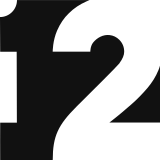

# DoceInk · Metalio

**English** | [Español](README.es.md)

Firmware for **Metalio E-Ink4**, an e-paper reader powered by an ESP32-S3 with 16 MB of flash. Books, local tasks, voice conversations with ChatGPT, RSS news, weather, a clock, a calculator and games in one interface.

**Documented version: 0.75.147.** This repository provides downloads and documentation for installing and using Metalio.

## Install from scratch

### [Download for Windows — connect Metalio and run](https://github.com/Faga250885/Doceink/releases/download/v0.75.147/DoceInk-Setup-0.75.147.exe)

**Connect Metalio → open the `.exe` → click Install.** No Python, terminal commands or separate firmware download. English by default; Spanish is available in the language selector.

Follow the **[step-by-step installation guide](docs/INSTALLATION.md)** for requirements, USB installation on Windows, the macOS/Linux alternative and connection troubleshooting.

The package is built from firmware build outputs and system resources. **It contains no developer accounts, API keys, saved Wi-Fi networks, conversations or personal files.** Each user sets up their own Metalio.

> A clean installation replaces the target Metalio's internal flash, erasing its accounts and settings. **It does not erase the microSD card.** Use an empty card if you also want to start without previous books, tasks or conversations.
>
> Validation status: firmware build, software tests, ZIP integrity and blank image regions verified. A complete clean installation has not yet been validated on a physical Metalio.

## Choose the right download

| I want to… | File or method | What happens to my data |
| --- | --- | --- |
| Install from scratch on compatible hardware | `DoceInk-Setup-0.75.147.exe`, over USB | Replaces internal flash; preserves the microSD card |
| Update Metalio with Doceink already installed | Settings → System → Information → Check for updates | Preserves accounts, settings and files |
| Download the update firmware | `Doceink-EInk4.bin` in Releases | Contains the OTA application, not a complete installer |

**Do not use `Metalio-instalacion-limpia.bin` for Wi-Fi updates.** Copying the full image to the microSD card is not an installation method either; follow the USB installation guide.

- [Latest release and downloads](https://github.com/Faga250885/Doceink/releases/latest)
- [Update without erasing your data](docs/UPDATES.md)
- [SHA-256 checksums for 0.75.147](SHA256SUMS.txt)
- [Release history](https://github.com/Faga250885/Doceink/releases)

## Features

At power-on, the original DoceInk symbol appears centered with **DoceInk** beneath it for two seconds before the main screen.

| Section | Features |
| --- | --- |
| Books | Library, covers, reading and typography controls |
| Tasks | Local Personal and Work lists; dictation over Wi-Fi |
| ChatGPT | Voice conversations and microSD history; requires your own API key |
| News | Multiple RSS sources, microSD cache and manual refresh |
| Weather | Forecast stored on microSD and manual refresh |
| Clock | Clock, pomodoro, stopwatch and countdown |
| Files | USB disk mode and QR-based Wi-Fi transfers through your phone's browser |
| Home and settings | Customizable shortcuts, wallpapers, battery, connectivity and preferences |
| Other apps | Calculator and games |

New conversations and dictation require internet access and the corresponding account setup. Saved history and downloaded data are read from the microSD card. News and Weather need an initial download before content is available offline.

## Getting started

1. Install the firmware and start Metalio.
2. Insert your microSD card and set up a 2.4 GHz Wi-Fi network.
3. Add books and wallpapers through **Settings → Files**.
4. Configure your RSS sources, city and, if you plan to use ChatGPT, your API key.

See [Getting started](docs/GETTING-STARTED.md) for controls, folders and file transfers. Some firmware menu labels may still appear in Spanish; the guides include the relevant Spanish names.

## Compatibility and support

This installer is intended **only for Metalio E-Ink4 with an ESP32-S3 and 16 MB of flash**. It is not a universal firmware for arbitrary e-readers or ESP32 boards.

- [FAQ and troubleshooting](docs/FAQ.md)
- [Report an issue](https://github.com/Faga250885/Doceink/issues/new?template=bug-report.md)
- [License included with the firmware](LICENSE)

The firmware uses ESP-IDF, LVGL and other third-party components, which retain their respective licenses. The main license does not replace those component licenses.

Created by **Franko García** · Faga12@gmail.com
