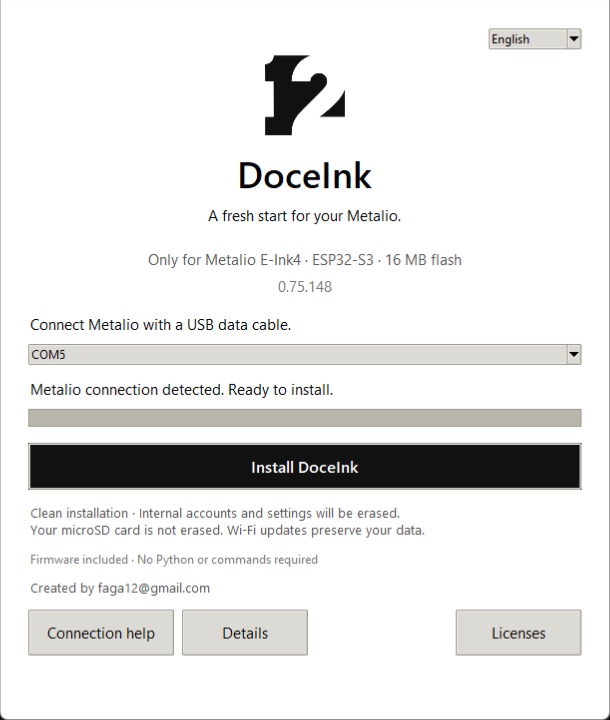

# Instalar DoceInk

[English](INSTALLATION.md) | **Español**

[Volver al inicio](../README.es.md)

## Windows: conectar y ejecutar

1. [Descarga DoceInk Setup 0.75.148](https://github.com/Faga250885/Doceink/releases/download/v0.75.148/DoceInk-Setup-0.75.148.exe).
2. Conecta **Metalio E-Ink4** con un cable USB de datos. Desactiva Disco USB si está activo.
3. Abre el `.exe`. Incluye firmware y herramientas: no necesitas Python, comandos ni otra descarga.
4. El instalador selecciona automáticamente una conexión USB ESP compatible cuando solo hay una. Si hay varios dispositivos, selecciona tu Metalio o desconecta los demás.
5. Elige **Español** arriba, pulsa **Instalar DoceInk**, confirma y mantén el USB conectado hasta que termine. Metalio se reiniciará.



## Qué pasa con los datos

**Esta es una instalación limpia por USB. Reemplaza la memoria interna y borra cuentas, redes y ajustes del Metalio seleccionado.** Pide confirmación antes de escribir. La microSD no se borra. Usa una tarjeta vacía si también quieres empezar sin libros, tareas ni historiales anteriores.

**Las actualizaciones normales por Wi-Fi conservan los datos del usuario.** Si ya tienes DoceInk y quieres conservar tus ajustes, utiliza [Actualizar](ACTUALIZACIONES.md), no el instalador limpio.

El paquete no contiene cuentas, contraseñas, claves API ni conversaciones personales del desarrollador. Cada usuario configura su propia red y cuentas.

## Requisitos y comprobaciones

- Metalio E-Ink4, ESP32-S3 y **flash de 16 MB**. No está preparado para otras placas.
- Windows 10/11 de 64 bits x86 y cable USB de datos.
- El firmware viene incluido; no hace falta descargar nada durante la instalación.
- El instalador verifica tamaño y SHA-256 de la imagen, rechaza otros chips ESP y comprueba que la memoria sea de 16 MB antes de escribir. No puede distinguir todas las placas que usan ese mismo chip; conecta únicamente el modelo de Metalio indicado.

[SHA256SUMS.txt](../SHA256SUMS.txt) contiene las huellas de los archivos. El ejecutable todavía no tiene firma digital, por lo que Windows puede mostrar un aviso de editor desconocido o SmartScreen. Descárgalo de la publicación oficial y verifica el archivo si Windows solicita revisarlo; no es necesario cambiar el antivirus.

## Si no detecta Metalio

Pulsa **Ayuda de conexión**. Revisa el cable de datos, desactiva Disco USB y cierra programas que estén usando el puerto serie.

Normalmente se puede entrar automáticamente en modo de descarga. Si tu conexión no lo permite, mantén el botón físico **BOOT** al reiniciar Metalio, suéltalo y reintenta. BOOT es el botón de hardware GPIO0, no el botón rojo táctil de la interfaz. Consulta las instrucciones del fabricante para localizarlo. El puerto puede cambiar; el instalador actualiza la lista automáticamente.

No desconectes el USB mientras escribe. Si falla, muestra detalles y permite reintentar; no informa que terminó correctamente si la operación falló.

## Primer inicio

Metalio debería reiniciarse y mostrar el símbolo con **DoceInk** debajo durante dos segundos antes de la pantalla principal. Si permanece en modo de descarga, reinicia sin mantener BOOT. Sigue los [primeros pasos](PRIMEROS-PASOS.md) para configurar microSD, Wi-Fi y cuentas.

## Instalación avanzada: macOS/Linux o recuperación manual

Descarga el [ZIP de imagen completa](https://github.com/Faga250885/Doceink/releases/download/v0.75.148/Metalio-0.75.148-instalacion-limpia.zip) y extráelo. Su imagen se llama `Metalio-instalacion-limpia.bin`. En Windows normalmente basta con el `.exe`.

En una terminal dentro de la carpeta extraída:

```sh
python3 -m venv .venv
source .venv/bin/activate
python -m pip install esptool==4.12.0
```

Comprueba la imagen con `shasum -a 256 Metalio-instalacion-limpia.bin` en macOS o `sha256sum Metalio-instalacion-limpia.bin` en Linux. La huella debe ser:

```text
d98256c5a2c0dfe308a33763f85233d12cfd4ae379a092114e9bcc43ed802ebf
```

Sustituye `PUERTO` por el puerto serie real, normalmente `/dev/cu.usbmodem…` en macOS o `/dev/ttyACM…` en Linux. **Este comando escribe directamente y borra los ajustes internos; no muestra la confirmación del instalador de Windows.**

```sh
python -m esptool --chip esp32s3 --port PUERTO --baud 460800 write_flash --flash_mode dio --flash_freq 80m --flash_size 16MB 0x0 Metalio-instalacion-limpia.bin
```

Se utiliza [esptool 4.12.0 de Espressif](https://pypi.org/project/esptool/4.12.0/). Si se deniega acceso al puerto, revisa los permisos del sistema. La instalación desde macOS/Linux no se ha probado físicamente.

## Validación y contenido

La compilación del firmware, las pruebas del arranque, pantalla y entrada táctil, y las pruebas de seguridad del instalador pasaron. El ejecutable empaquetado pasó las comprobaciones de integridad e interfaz sin abrir puertos USB. **La instalación limpia completa en un Metalio físico sigue pendiente de validación.**

La imagen completa incluye arranque, particiones, aplicación, fuentes y recursos del sistema. Las regiones NVS, PHY, segunda partición de aplicación y volcados de errores están vacías. Consulta el [manifiesto](releases/v0.75.148-manifest.json).

La imagen mide 16 MB porque incluye espacio vacío. La aplicación ocupa **4.989.072 bytes**. Ni la imagen completa ni el `.exe` sirven como archivo OTA: para actualizar se utiliza `Doceink-EInk4.bin`.
