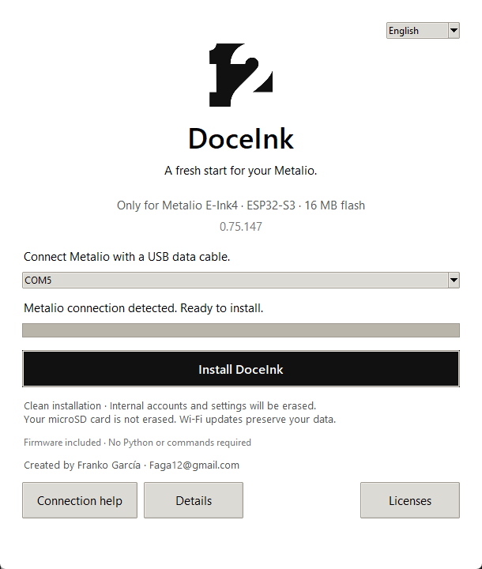

# Install DoceInk

**English** | [Español](INSTALACION.md)

[Back to the main page](../README.md)

## Windows: connect and run

1. [Download DoceInk Setup 0.75.147](https://github.com/Faga250885/Doceink/releases/download/v0.75.147/DoceInk-Setup-0.75.147.exe).
2. Connect **Metalio E-Ink4** with a USB data cable. Disable USB disk mode if it is active.
3. Open the downloaded `.exe`. It includes the firmware and tools; you do not need Python, a terminal or another download.
4. The installer automatically selects a single matching ESP USB connection. If several devices are connected, select your Metalio or disconnect the others.
5. Click **Install DoceInk**, confirm the clean installation and keep USB connected until it finishes. Metalio then restarts.

The installer opens in English. Select **Español** at the top for Spanish prompts.



## What happens to my data?

**This is a clean USB installation. It replaces internal flash and erases accounts, saved networks and settings on the selected Metalio.** It asks for confirmation before writing. The microSD card is not erased. Use an empty card if you also want to start without previous books, tasks or history.

**Normal Wi-Fi updates preserve user data.** If DoceInk is already installed and you want to keep your settings, use [Updates](UPDATES.md), not the clean installer.

The firmware package does not include developer accounts, passwords, API keys or personal conversations. After installation, configure your own network and accounts.

## Requirements and checks

- Metalio E-Ink4, ESP32-S3, **16 MB flash**. Other boards are not supported.
- Windows 10/11, 64-bit x86, and a USB data cable.
- The included firmware works without downloading anything during installation.
- The installer checks the image size and SHA-256, rejects a different ESP chip, and checks for 16 MB flash before writing. These checks cannot identify every board that uses the same ESP32-S3 chip; connect only the specified Metalio model.

[SHA256SUMS.txt](../SHA256SUMS.txt) lists the executable and firmware checksums. The executable is currently unsigned, so Windows may display an unknown-publisher or SmartScreen notice. Obtain it from this repository's release and verify the download if Windows asks you to review it; no antivirus changes are required.

## If Metalio is not detected

Use **Connection help** in the installer. Check the data cable, turn off **Disco USB / USB disk** on Metalio, and close serial-terminal programs.

Most compatible USB connections can enter download mode automatically. If yours cannot, hold the physical **BOOT** button while restarting Metalio, release it, and retry. BOOT is the GPIO0 hardware button, not the red touch button in the interface. Consult the manufacturer's instructions to locate it. The serial port may change; the installer refreshes the list automatically.

Do not disconnect USB during installation. If an error occurs, the installer shows details and allows you to retry. It does not report success after a failed operation.

## After installation

Metalio should restart and show the DoceInk symbol and name for two seconds before the main screen. If it remains in download mode, restart without holding BOOT. Follow [Getting started](GETTING-STARTED.md) to configure your microSD, Wi-Fi and accounts.

## Advanced installation: macOS/Linux or manual recovery

Download the [full-image ZIP](https://github.com/Faga250885/Doceink/releases/download/v0.75.147/Metalio-0.75.147-instalacion-limpia.zip) and extract it. The image is `Metalio-instalacion-limpia.bin`; that filename is retained for compatibility. Windows users normally do not need this ZIP.

In a terminal inside the extracted folder:

```sh
python3 -m venv .venv
source .venv/bin/activate
python -m pip install esptool==4.12.0
```

Check the full image with `shasum -a 256 Metalio-instalacion-limpia.bin` on macOS or `sha256sum Metalio-instalacion-limpia.bin` on Linux. Expected SHA-256:

```text
88a3522d9c07837c9e972b676a29e7398bddfbb7b26d61900ba4739ab1bfce8a
```

Replace `PORT` with the actual serial port. Typical names are `/dev/cu.usbmodem…` on macOS or `/dev/ttyACM…` on Linux. **This manual command writes directly, erases internal settings and does not show the Windows installer's confirmation.**

```sh
python -m esptool --chip esp32s3 --port PORT --baud 460800 write_flash --flash_mode dio --flash_freq 80m --flash_size 16MB 0x0 Metalio-instalacion-limpia.bin
```

This uses [Espressif's esptool 4.12.0](https://pypi.org/project/esptool/4.12.0/). If serial access is denied, check your operating system's device permissions. The macOS/Linux flashing route has not been tested on physical hardware.

## Validation and image contents

The firmware compiles successfully. Startup rendering, display/input regression tests and installer safety tests passed. The packaged Windows executable passed firmware-integrity and GUI smoke tests without opening a USB port. **A full clean installation on a physical Metalio remains pending validation.**

The complete image contains the bootloader, partition table, application, fonts and system resources. NVS, PHY data, the second application partition and crash-dump regions are blank. See the [manifest](releases/v0.75.147-manifest.json).

The image is 16 MB including empty space. The application is **4,988,880 bytes**. Neither the complete image nor the `.exe` is an OTA file; use `Doceink-EInk4.bin` for firmware updates.
